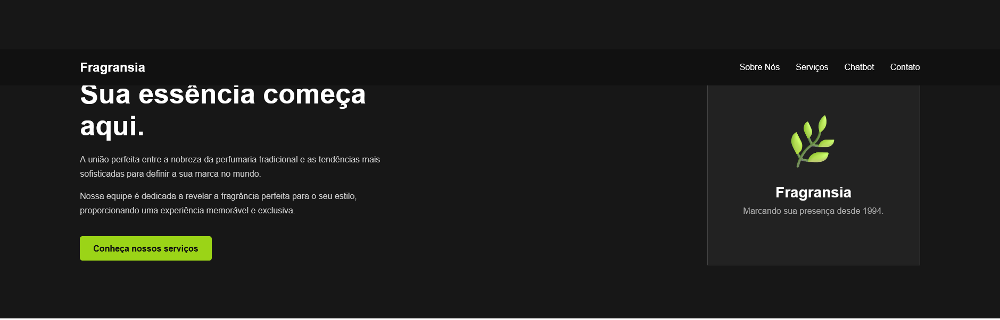
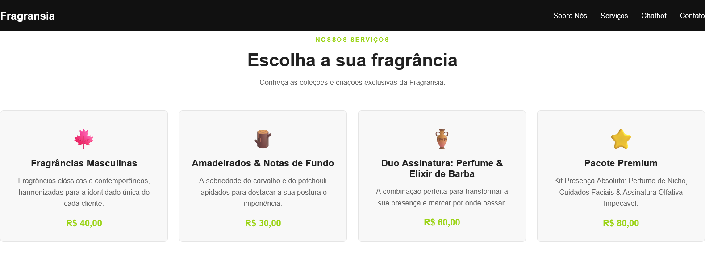
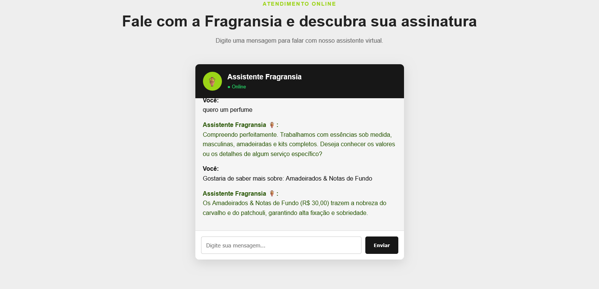

# 🏺 Fragransia — Perfumaria & Cosméticos Exclusivos

Landing page institucional e interativa desenvolvida para a marca **Fragransia**, especializada em perfumaria nobre, fragrâncias masculinas lapidadas e rituais de autocuidado. O projeto conta com design responsivo, catálogo de produtos/serviços e um assistente virtual interativo (chatbot) integrado no front-end.

---

## 📸 Demonstração do Projeto

<!-- Substitua o caminho abaixo pela captura do seu projeto -->





---

## ✨ Funcionalidades

- **Identidade Visual Sofisticada:** Estilização com paleta escura, acabamentos minimalistas e contrastes modernos em verde-oliva.
- **Navegação Fluida:** Transições suaves entre as seções (*Sobre Nós*, *Serviços* e *Chatbot*).
- **Catálogo de Serviços Interativo:** Cards detalhados com valores e opções. Clicar em qualquer serviço direciona automaticamente a dúvida para o campo do assistente virtual.
- **Chatbot Integrado:** Assistente virtual com processamento de texto, normalização de termos e respostas automáticas para dúvidas sobre preços, notas olfativas e informações da marca.
- **Design 100% Responsivo:** Interface otimizada para desktops, tablets e smartphones.

---

## 🛠️ Tecnologias Utilizadas

- **HTML5:** Estruturação semântica da página.
- **CSS3:** Flexbox, CSS Grid, variáveis de cores e media queries para responsividade.
- **JavaScript (ES6+):** Manipulação do DOM, simulação de respostas do chatbot e regras de interação com os cards.

---

## 📂 Estrutura de Arquivos

```plaintext
fragransia/
├── assets/              # Capturas de tela, logos e ícones
│   ├── preview-landing.png
│   └── preview-chat.png
├── index.html           # Estrutura principal da landing page
├── style.css            # Folha de estilo e regras de layout
├── script.js           # Lógica do assistente virtual e interações
└── README.md            # Documentação do projeto
